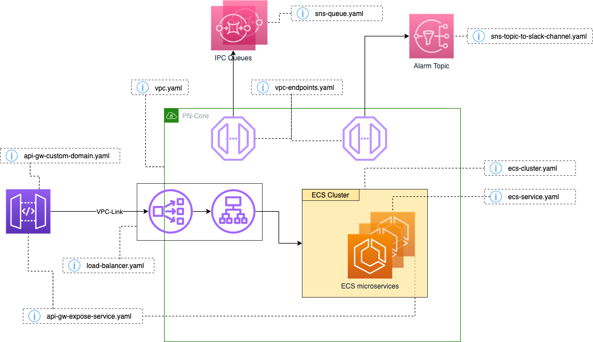

# High Level Description

This diagram is the hight level view of the infrastructure created by 3 different templates.

- [Once 4 account](once4account) creates _Alarm Topic_ 
- [pn-ipc.yaml](pn-ipc.yaml) create the SQS queues used to comunicate between microservices
- [pn-infra.yaml](pn-infra.yaml) all the rest except _ECS microservices_

The _ECS microservices_ and their API exposition are configured in each microservice project using the 
[ecs-service.yaml](fragments/ecs-service.yaml) and 
[api-gw-expose-service.yaml](fragments/api-gw-expose-service.yaml) CFN templates fragments.

## SQS DLQ message alarm

The [SQS fragment](fragments/sqs-queue.yaml) configures `DLQHasMessagesAlarm`
with these optional parameters:

| Parameter | Default | Meaning |
| --- | --- | --- |
| `DLQHasMessagesAlarmPeriodSeconds` | 60 | Metric period in seconds, a multiple of 60 |
| `DLQHasMessagesAlarmDatapointsToAlarm` | 1 | Breaching datapoints required to enter ALARM (M) |
| `DLQHasMessagesAlarmEvaluationPeriods` | 10 | Periods in the rolling evaluation window (N) |

M must not exceed N. CloudWatch validates the period and M/N combination.
With complete metric samples, the default requires only one breaching
datapoint in ten one-minute periods, not ten consecutive breaches. A breach
remains relevant while it is in that window, reducing immediate ALARM/OK
transitions during queue dumps.

This is not a fixed ten-minute timer. `TreatMissingData: notBreaching` is
unchanged; missing samples affect evaluation, so a ten-minute ALARM duration
is not guaranteed.

Existing callers can omit these parameters and use the shared defaults.
This change does not expose parameters in microservice templates.
Deployed alarms adopt the defaults when their nested stacks are updated
with the new fragment revision; publishing the fragment alone is not enough.
Message thresholds, notification actions and all other alarm types are unchanged.
